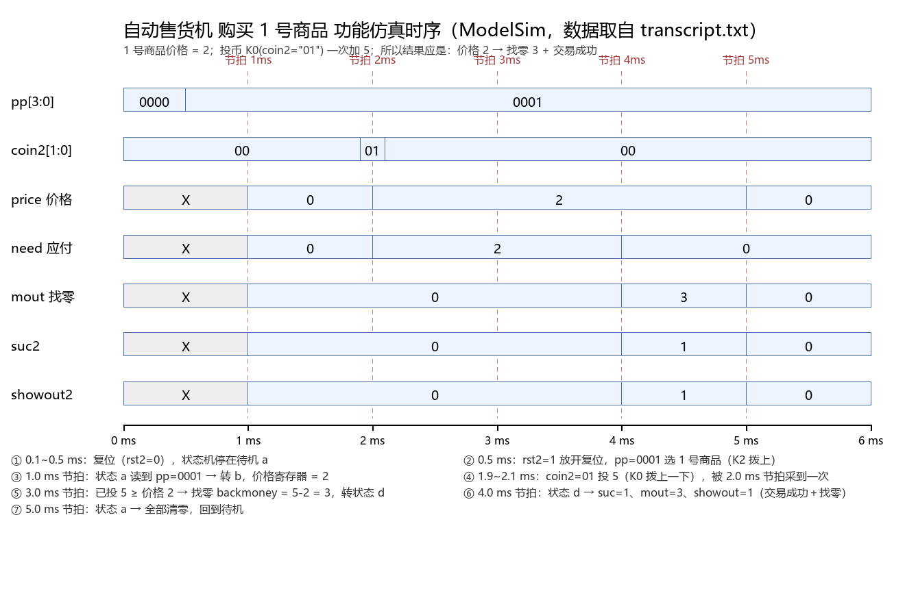

# 仿真说明：购买 1 号商品

> 工程：`D:\altera\13.0\kirarl.vhdl\vending_machine`
> 仿真文件：[sim/tb_dingceng.vhd](sim/tb_dingceng.vhd)（6 ms 版）、[sim/tb_dingceng_fast.vhd](sim/tb_dingceng_fast.vhd)（0.5 µs 快速版）、[sim/run_sim.do](sim/run_sim.do)
> 记录与波形：[sim/transcript.txt](sim/transcript.txt)、[sim/transcript_fast.txt](sim/transcript_fast.txt)、[sim/wave_buy_item1.png](sim/wave_buy_item1.png)
> Quartus 波形激励：[sim/wave_quartus_buy_item1.vwf](sim/wave_quartus_buy_item1.vwf)（见第十节）

---

## 一、仿真目的

对整机顶层 `dingceng` 做一次**功能仿真**，走完一次完整交易：

**选 1 号商品 → 投币 → 判断金额 → 找零 → 交易成功 → 回到待机**

## 二、场景设定

| 项目 | 取值 | 依据 |
|---|---|---|
| 商品 | 1 号 | `shouhuoji.vhd` 状态 a 里 `choose="0001"` 对应 K2 |
| 价格 | **2** | `pricetemp <= "0010"` |
| 投币 | **5** | `coin2="01"`（拨 K0），`paidtemp + 5` |
| 应找零 | 5 − 2 = **3** | 状态 d：`backmoney <= paidtemp - pricetemp` |

> `coin2="10"`（K1）一次加 1；两个开关都拨着就是 6。

## 三、仿真环境与时钟

- 工具：ModelSim-Altera 10.1d（Quartus II 13.0 自带），**源文件级功能仿真**，不需要先跑 Quartus 综合。
- `clk20`：10 ns 周期。
- `fp.vhd` 分频：`SCAN_DIV = 1000` → 扫描时钟 1 kHz；`TICK_DIV = 100000` → **状态机节拍 10 Hz，即 1 ms 一拍**。
- 仿真总时长 **6 ms**（约 60 万个时钟周期），足够走完一次交易并回到待机。

## 四、激励时序

| 时间 | `rst2` | `pp` | `coin2` | 说明 |
|---|---|---|---|---|
| 0 ~ 0.5 ms | 0 | 0000 | 00 | 复位，状态机停在待机 a |
| 0.5 ms | **1** | **0001** | 00 | 放开复位，拨 K2 选 1 号商品 |
| 1.9 ~ 2.1 ms | 1 | 0001 | **01** | 拨 K0 投 5（必须跨过节拍沿，见下） |
| 2.1 ~ 6.0 ms | 1 | 0001 | 00 | 松手；6.0 ms 仿真结束 |

**为什么投币窗口取 1.9~2.1 ms**：状态机是在**节拍沿**（1.0 / 2.0 / 3.0 ms…）采样 `coin` 的，
窗口必须"跨过"某个节拍沿，才能保证**恰好被采到一次**——这也是绕开"开关一直拨着会被重复计数"那个问题的办法。

## 五、仿真结果（`transcript.txt` 原文）

```
# ** Note: t=0 us    | price_disp=? I1=0000000 | need_disp=? I2=0000000 | mout_disp=? I3=0000000 | suc=X showout=X
# ** Note: t=999 us  | price_disp=? I1=0000000 | need_disp=? I2=0000000 | mout_disp=? I3=0000000 | suc=0 showout=0
# ** Note: t=999 us  | price_disp=0 I1=0111111 | need_disp=0 I2=0111111 | mout_disp=0 I3=0111111 | suc=0 showout=0
# ** Note: t=1999 us | price_disp=2 I1=1011011 | need_disp=2 I2=1011011 | mout_disp=0 I3=0111111 | suc=0 showout=0
# ** Note: t=3999 us | price_disp=2 I1=1011011 | need_disp=2 I2=1011011 | mout_disp=0 I3=0111111 | suc=1 showout=1
# ** Note: t=3999 us | price_disp=2 I1=1011011 | need_disp=0 I2=0111111 | mout_disp=3 I3=1001111 | suc=1 showout=1
# ** Note: t=4999 us | price_disp=2 I1=1011011 | need_disp=0 I2=0111111 | mout_disp=3 I3=1001111 | suc=0 showout=0
# ** Note: t=4999 us | price_disp=0 I1=0111111 | need_disp=0 I2=0111111 | mout_disp=0 I3=0111111 | suc=0 showout=0
# ** Failure: ==== SIM END: buying item 1 finished (price=2, paid=5, change=3) ====
```

（`X` 是上电初值未知，几拍之后就被复位清成 0；`SIM END` 那行是测试平台用 `severity FAILURE` 主动结束仿真。）

## 六、结果分析



| 节拍 | 状态机动作 | 数码管（I1 价格 / I2 应付 / I3 找零） | suc / showout |
|---|---|---|---|
| 1.0 ms | 状态 a 读到 `pp=0001` → 转入 b，价格寄存器 = 2 | 0 / 0 / 0 | 0 / 0 |
| 2.0 ms | 状态 b 采到 `coin2=01` → 已投金额 = 5；`price<=2`、`need<=2` | **2 / 2** / 0 | 0 / 0 |
| 3.0 ms | 已投 5 ≥ 价格 2 → 找零寄存器 = 5−2 = **3**，转入 d | 2 / 2 / 0（显示未变，见注①） | 0 / 0 |
| 4.0 ms | 状态 d：交易成功、送出找零 | 2 / **0** / **3** | **1 / 1** |
| 5.0 ms | 状态 a：全部清零，回到待机 | **0 / 0 / 0** | 0 / 0 |

**结论**：一次完整交易用 4 个节拍走完（≈0.4 s，10 Hz 节拍下很快），
价格 2、投 5、找零 3、`suc` 与 `showout` 都正确给出脉冲，符合设计预期。

> 注①：状态机在 3.0 ms 那一拍就已经判定"钱够了"，但 `need` 的显示要等到 4.0 ms 才从 2 变 0。
> 原因是 `shouhuoji.vhd` 里 `need <= needtemp` 这种"寄存器赋值慢一拍"的写法，
> 功能上没错，但界面上会慢一个节拍，知悉即可。

## 七、七段码对照（看懂 I1/I2/I3）

`xianshi.vhd` 的编码表是"位序 g f e d c b a、1 点亮"：

| 字符 | 7 位码 | 字符 | 7 位码 |
|---|---|---|---|
| 0 | 0111111 | 5 | 1101101 |
| 1 | 0000110 | 6 | 1111101 |
| 2 | **1011011** | 7 | 0000111 |
| 3 | **1001111** | 8 | 1111111 |
| 4 | 1100110 | 9 | 1101111 |

本次仿真只用到 0(0111111)、2(1011011)、3(1001111) 三个码。

## 八、怎么复现这次仿真

**ModelSim（推荐，和本次一致）** —— 在 `sim` 目录下：

```bat
vlib work
vcom -93 ../fp.vhd ../shouhuoji.vhd ../xianshi.vhd ../dingceng.vhd tb_dingceng.vhd
vsim -c -do "run -all; quit -f" work.tb_dingceng
```
或用现成的脚本（GUI 里会带波形窗口）：`vsim -do run_sim.do`

产物：`sim\transcript.txt`（文字记录）、`sim\wave_buy_item1.png`（时序图，由 `draw_wave.py` 按 transcript 生成）。

**想跑快一点（0.5 µs 出结果）—— 快速分频模式**

1. 把 `fp.vhd` 里的开关改成 `CONSTANT SIM_MODE : BOOLEAN := TRUE;`
   （分频比随之变成 `SCAN_DIV=4`、`TICK_DIV=10`，即扫描周期 40 ns、节拍 100 ns）；
2. 换用快速版测试平台 `sim/tb_dingceng_fast.vhd`：

```bat
vcom -93 ../fp.vhd ../shouhuoji.vhd ../xianshi.vhd ../dingceng.vhd tb_dingceng_fast.vhd
vsim -c -do "run -all; quit -f" work.tb_dingceng_fast
```

3. **仿完记得把 `SIM_MODE` 改回 `FALSE`**（下载到板子前必须改回来）。

实测结果（`sim\transcript_fast.txt`）与 6 ms 版一一对应，只是时间轴缩了一万倍：

| 节拍 | 快速模式时间 | 显示 / 状态 |
|---|---|---|
| 第 1 拍 | 95 ns | 待机：0 / 0 / 0 |
| 第 2 拍 | 195 ns | 价格 2、应付 2（选中商品 + 采到投币 5） |
| 第 3 拍 | 295 ns | 判定 5 ≥ 2，找零寄存器 = 3，转状态 d |
| 第 4 拍 | 395 ns | **找零 3、suc=1、showout=1**（交易成功） |
| 第 5 拍 | 495 ns | 全部清零，回待机 |

**Quartus 自带 VWF 仿真** —— 顶层保持 `dingceng`，新建 .vwf 后按下表设激励，
并把 `End Time` 设成 **6 ms**：

| 信号 | 激励 |
|---|---|
| `clk20` | 周期时钟，10 ns（5 ns 低 + 5 ns 高），`REPEAT` 到 6 ms |
| `rst2` | 0 ns 起为 0，0.5 ms 后变 1 |
| `pp` | 0.5 ms 起为 0001 |
| `coin2` | 1.9 ms 起为 01，2.1 ms 变回 00 |

> 注意：按现在的分频常数，一个节拍要 1 ms、整个交易要 6 ms，VWF 的仿真时间必须拉到 ms 级；
> 想快速看结果，可以临时把 `fp.vhd` 的 `TICK_DIV` 从 100000 改成 1000（一拍变成 10 µs，整个交易只要 60 µs），
> 仿真完再改回 100000 —— 上机时必须用原值。

## 九、需要说明的几点（避免误解）

1. 这是**功能仿真**（源文件级），不含器件延时和引脚时序；上板实测的波形会有延时，但逻辑一致。
2. 仿真里看的是 `I1/I2/I3` 三路独立的七段码（和教材图 7.15 一致）；
   上板后数码管只有一组 `seg/sel`，由顶层 `dingceng` 以 1 kHz 轮显这三位，所以实物上看到的是"三个数字轮流亮"。
3. 本次投币窗口只有 0.2 ms，**恰好被采一次**。若把 K0 一直拨着，每个节拍都会加 5 —— 这就是之前提过的
   "投币重复计数"问题，本次仿真特意避开了它。
4. 找零 3 只在 4.0~5.0 ms 显示一个节拍（0.1 s），肉眼几乎看不清；
   若要在实物上看清"找零金额"，应在状态 d 里加一段停留（例如用 `tick` 计数停留 2 秒再回待机）。
5. 仿真结束那句 `** Failure:` 是测试平台主动用 `severity FAILURE` 终止 `run -all` 的手段，
   **不是设计出错**；`SIM END` 后面的文字就是本次的结论。

---

## 十、关于"Quartus 里 End Time 只能设到 100 µs"

**结论：能完整复现，但要换一条路。**

### 1. Quartus II 13.0 自带仿真器不支持 Cyclone IV E

实测（2026-10-11）执行 `Processing → Generate Functional Simulation Netlist`（或命令行
`quartus_map vending_machine --generate_functional_sim_netlist`）会直接失败：

```
Error (281041): Quartus II Simulator does not support device family Cyclone IV E
```

也就是说 **Simulator Tool 这条路对本工程根本走不通**，
100 µs 的上限不是"设置技巧"能绕开的 —— 这个内置仿真器在这颗器件上就用不了。

### 2. 能用的仿真器是 ModelSim

Quartus 13.0 自带 **ModelSim-Altera 10.1d**，指导书里的"波形仿真"也是按它写的。
ModelSim **没有 100 µs 上限**：本文第六节那个 **6 ms** 的仿真是它的正常能力，
`sim\仿真.bat` 里那条命令走的就是这条路。

### 3. 如果一定要用波形文件（VWF / Simulation Waveform Editor）

我已经把激励配好了一份：**`sim\wave_quartus_buy_item1.vwf`**

| 信号 | 激励 |
|---|---|
| `clk20` | 10 ns 周期（5 ns 低 + 5 ns 高），`REPEAT=100`，正好铺满 1 µs |
| `rst2` | 0 ns 起为 0，50 ns 拉高为 1 |
| `pp` | 50 ns 起为 `0001`（选 1 号商品） |
| `coin2` | 190 ns 起为 `01`（投 5），210 ns 变回 `00` |

总时长 **1000 ns = 1 µs**，只有 100 µs 上限的 1%。

**使用前提**：先把 [fp.vhd](fp.vhd) 里的 `SIM_MODE` 改成 `TRUE`（分频比变成 `SCAN_DIV=4`、`TICK_DIV=10`），
再走 `Run Functional Simulation`（该流程底层同样调用 ModelSim）；仿真完把 `SIM_MODE` 改回 `FALSE`。

> 生成这份 .vwf 的脚本是 `sim\make_quartus_vwf.py`（以工程里 `Waveform.vwf` 的端口列表为模板，
> 只替换输入信号的 TRANSITION_LIST），以后换场景可以改脚本里的时间重新生成。

### 4. 一句话总结

- **换 ModelSim**（`sim\仿真.bat`）→ 直接跑 6 ms 那版，完整复现；
- **受 100 µs 限制的工具** → 打开 `SIM_MODE`，配 `wave_quartus_buy_item1.vwf`，整笔交易 **0.5 µs** 跑完。

> ⚠️ 无论走哪条路，**下载到板子前一定要确认 `fp.vhd` 里 `SIM_MODE = FALSE`**，否则节拍会快 1 万倍，实物上看不出正常动作。
